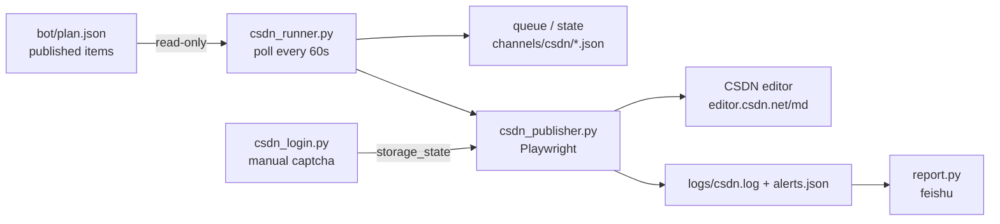

# CSDN 分发通道设计

Feature Name: csdn-distribution
Updated: 2026-11-12

## Description

在现有 openlab 发文链路之外，新增一个独立、可暂停、可观测的 CSDN 分发进程。分发进程只读 `bot/plan.json`，把已发布文章投递到 CSDN Markdown 编辑器，并把结果写入自己的状态文件。原渠道代码零改动。

登录采用人工验证码 + 登录态持久化：登录助手保存验证码截图，用户在聊天中回填，登录成功后保存 cookie/localStorage；之后自动复用，失效时暂停并告警。

## Architecture



隔离边界：

- 分发进程不导入 `publish.py`、`one_shot.py`，不修改 `plan.json`。
- 分发进程拥有独立 flock、独立日志、独立重试计数。
- 原渠道失败与分发失败互不传播。

## Components and Interfaces

### csdn_runner.py

- 入口：`--loop`（常驻）、`--once`（跑一轮）、`--dry-run`、`--backfill 7d`。
- 轮询 `plan.json`，筛选 `status == published` 且 `time >= now-7d`，按 `time` 升序。
- 与 `state.json` 对账，跳过已成功与正在处理的任务。
- 限速：全局最小间隔 180 秒，日上限 2 篇（平台硬限制，见下）。
- 失败重试：5/15/60 分钟，3 次后标记 `failed`。

### csdn_login.py

- 读取 `channels/csdn/credentials.json`（`0600`）。
- 打开 `https://passport.csdn.net/login`，切换密码登录，填写手机号与密码。
- 将验证码区域截图保存为 `logs/captcha.png`，在终端打印路径并等待用户输入验证码。
- 提交后校验登录成功，保存 `storage_state.json`。
- 不实现验证码自动识别；验证码只接受人工输入。

### csdn_publisher.py

- 输入：`{title, summary, body_md, cover_path, local_images[], column, tags[]}`。
- 打开 `https://editor.csdn.net/md/`，标题填入标题框。
- 正文通过 Markdown 编辑器写入；本地图片逐张通过编辑器上传控件上传，替换正文地址。
- 选择专栏（按名称映射到专栏 ID），设置标签（最多 5 个）。
- 上传封面，点击发布，等待跳转并解析文章 URL。
- 提供 `--dry-run`：只填表与截图，不提交。

### 配置

`channels/csdn/config.json`：

```json
{
  "enabled": true,
  "mode": "publish",
  "columns": {"人工智能": 0, "云计算": 0, "工业互联网": 0},
  "tags": {"人工智能": ["人工智能"], "云计算": ["云计算"], "工业互联网": ["工业互联网"]},
  "min_interval_sec": 180,
  "daily_limit": 20,
  "backfill_days": 7
}
```

`columns` 的值在登录后通过 CSDN 专栏接口拉取并回填。值为 0 时使用 CSDN 默认分类。

## Data Models

`state.json`：

```json
{
  "articles": {
    "38158": {"status": "success", "url": "https://blog.csdn.net/...", "time": "2026-11-12 10:00:00", "attempts": 1}
  },
  "counters": {"pending": 0, "success": 0, "failed": 0},
  "session": {"needs_login": false, "checked_at": "2026-11-12 09:00:00"}
}
```

`queue.json` 保存待处理任务快照，字段包含 `article_id`、`title`、`file`、`cover`、`body_image_files`、`time`、`attempts`、`next_try_at`。

## Correctness Properties

1. 幂等：同一 `article_id` 在 `state.json` 中最多一条 `success` 记录。
2. 隔离：分发进程任何异常不改变 `plan.json` 的字节内容。
3. 顺序：回填时按 `time` 升序，且任意两次发布间隔不小于 `min_interval_sec`。
4. 部分失败可恢复：图片上传失败时整篇重试，不使用半成品正文。
5. 凭据不落日志：日志只出现手机号掩码与文章标题。

## Error Handling

| 场景 | 处理 |
|------|------|
| 登录态失效 | 标记 `needs_login`，暂停队列，写告警 |
| 编辑器选择器变化 | 截图存档，标记 `selector_error`，连续 3 次告警 |
| 图片上传失败 | 整篇重试，最多 3 次 |
| 发布被风控拦截 | 暂停 6 小时，写告警，等待人工处理 |
| CSDN 5xx/超时 | 按 5/15/60 分钟重试 |
| 内容校验失败 | 跳过并记录原因，不重试 |

## Test Strategy

1. 登录助手：人工验证码完成一次登录，验证 `storage_state.json` 可复用。
2. 回填 dry-run：打印最近 7 天待分发清单，人工核对数量与时间范围。
3. 单篇灰度：先发 1 篇，核对标题、正文、图片、封面、专栏、标签与 URL。
4. 限速验证：连续 3 篇，检查间隔与日志。
5. 故障演练：删除 `storage_state.json`，确认原渠道不受影响且告警生成。
6. 幂等验证：重复运行一轮，确认不重复发布。

## References

[^1]: (File) - [bot/plan.json](../bot/plan.json)
[^2]: (File) - [bot/publish.py](../bot/publish.py)
[^3]: (File) - [bot/runner.py](../bot/runner.py)
[^4]: (Website) - [CSDN 登录](https://passport.csdn.net/login)
[^5]: (Website) - [CSDN Markdown 编辑器](https://editor.csdn.net/md/)

## 编辑器与平台限制（实测）

- 正文写入必须走 `ClipboardEvent` 粘贴 `text/plain`。用 `keyboard.insert_text` 会丢失换行，Markdown 标题变成字面量 `##`、段落黏连。
- 发布确认按钮全页有两个同名「发布文章」按钮，一个藏在隐藏的 `publish-timer-dialog` 里。用 `page.get_by_role("button", name="发布文章", exact=True).last` 取可见的那个，并用 `saveArticle` 请求监听验证真触发。
- 封面上传：选图后必须点「确认上传」（`.vicp-operate-btn`），等 `.vicp-crop` 裁剪层消失且出现新的 direct 图片 URL（与上传前列表比对）再按 Escape 收浮层；封面步骤要放在标签之前（标签联想面板会拦截点击），`_set_tags` 结束按 Escape 收面板。
- 单账号每日发文上限 2 篇：`POST /blog-console-api/v3/mdeditor/saveArticle` 返回 400，`code=400300001`，`msg=今天发表文章数量已达到限制的2篇。`。通道检测到「发文上限」后写入 `state.quota_blocked_date`，当日不再重试，次日 08:00 自动恢复。
- 分类专栏：`POST /blog/phoenix/console/v1/column/save` 最多 10 个；当前账号发布弹窗提示「您暂时不能添加分类专栏!」，文章无法挂载专栏，发布时只记录告警。
- 编辑既有文章：`https://editor.csdn.net/md?articleId=<id>`，发布按钮同样走保存流程。

## 一键分发看板（webui `/`）

- `webui.py` 根路径改为「一键分发」看板，登录中转台移到 `/relay`（预览代理只放行根路径，页面 JS 全部用 `new URL('.', location.href)` 相对路径取数）。
- 看板数据：`/api/overview`（登录态、daemon 存活、今日额度、队列长度、CSDN 已发布总数）+ `/api/articles?days=14`（plan.json 与 state.json/queue.json 合并：已发布/队列·置顶/失败/未分发）。
- 操作：「置顶发布」= 向 `queue.json` 队头插入 `priority:true` 任务（runner `process()` 对 priority 任务排序优先），「移出队列」= 从 `queue.json` 移除。实际发布仍由 runner daemon 在 60 秒轮询内执行，额度/时段/限速/登录失效处理全部复用 `can_run`，看板不直接发布。
- 重试失败文章：直接重新入队即可，`enqueue()` 的 known 集合含 failed 记录不会重复入队。
- `csdn_runner.py` 启动时写 `logs/runner.pid`、退出时清理，供看板存活检测。

## CSDN BizAPI 签名客户端（逆向自「CSDN同步助手」v1.2.1 扩展）

- `csdn_api.py`：纯 HTTP 访问 `https://bizapi.csdn.net`，免 UI。签名：`x-ca-key=203803574`、`x-ca-nonce=uuid4`，canonical headers 按名排序 `name:value` 换行连接；待签名串 `METHOD\n*/*\naccept\ncontent-type\n\n{canon}\n{path}`（GET 的 accept/content-type 为空，POST 为 `application/json`），`x-ca-signature=base64(HMAC-SHA256(secret, 待签名串))`。secret 与 key 一起内嵌在扩展里，现存放于 `csdn_api.py`。
- Cookie 复用 `storage_state.json` 中 `.csdn.net` 域 Cookie（UserToken 等）。
- **网关签名坑**：query 串参与签名时按端点固定 schema 顺序重建（实测 `article/list` 为 `pageNum,pageSize,status`），顺序不符或出现白名单外参数一律 401 `HMAC signature does not match`。已签名端点的参数顺序登记在 `csdn_api.QUERY_ORDER`，新增带参 GET 时先实测登记。
- 已验证：`user/list-permission`、`article/list`（200）。POST `saveArticle` 未灰度（额度限制），UI 发布器仍为主发布路径。
- 扩展架构结论：其「多平台同步」= 扩展自己持各平台登录 Cookie 直调各平台 web API（掘金 `content_api/v1/article_draft/create`、微博 `card.weibo.com/article/v5/aj/editor/draft/create|publish`、51CTO `blog.51cto.com/blogger/publish` 等）+ `declarativeNetRequest` 伪造 Origin/Referer；并向 CSDN `multi-platform-sync/report` 上报结果。扩展自带 MCP 协议（WS `127.0.0.1:3721`，token 校验）仅支持草稿。若要多平台分发，需为各平台做同样的「人工登录 + Cookie 持久化 + API 发布」流程。
